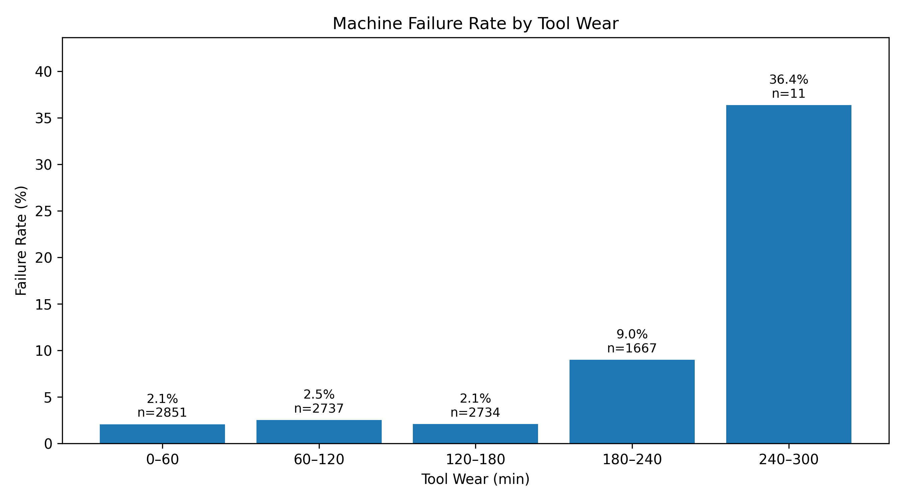
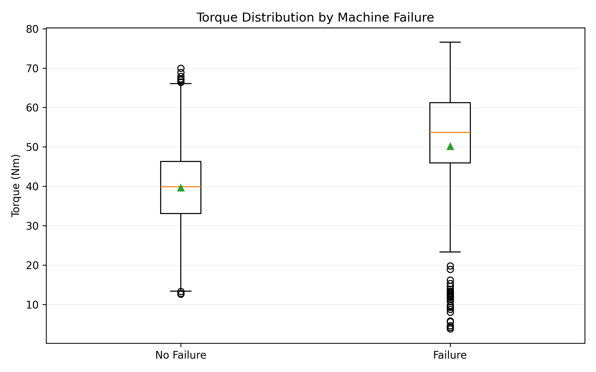
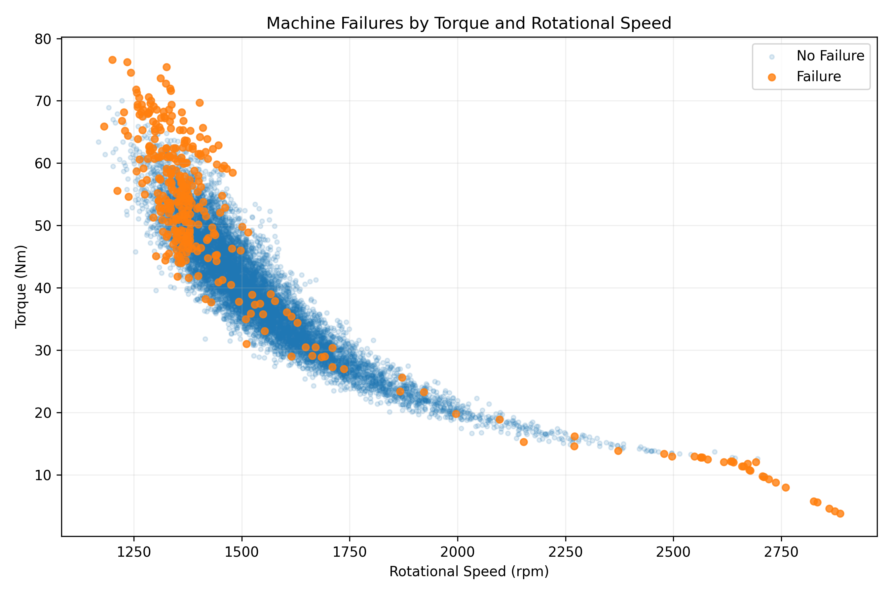
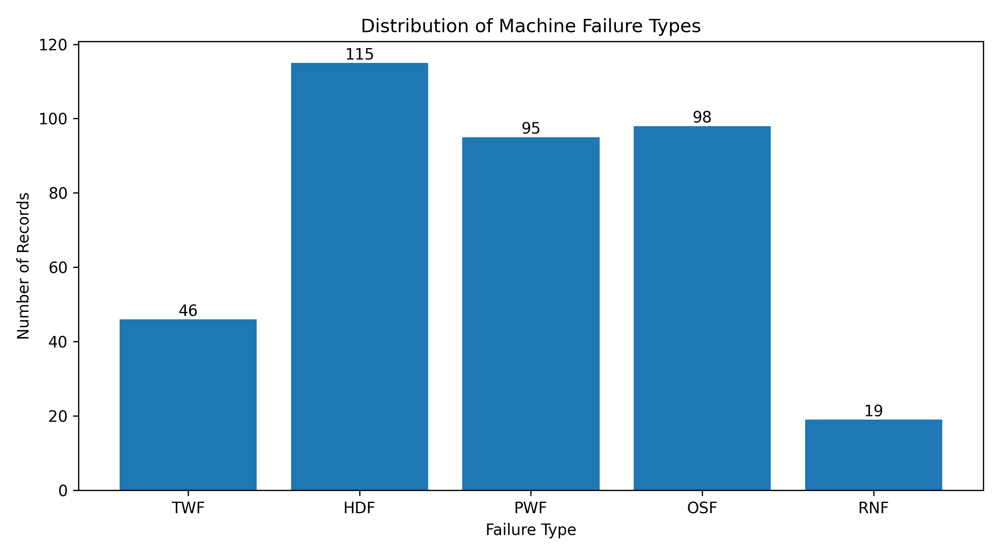

# Industrial Machine Failure Analysis
### Exploratory Data Analysis with Python, Pandas & Matplotlib

## Project Overview

This project explores machine failure patterns using the
AI4I 2020 Predictive Maintenance Dataset.

The objective is to investigate how operational parameters
such as torque, rotational speed, and tool wear are associated
with machine failures.

The project focuses on exploratory data analysis (EDA),
visualization, and data quality assessment rather than
machine learning or predictive modeling.

## Dataset

Source: UCI Machine Learning Repository

https://archive.ics.uci.edu/dataset/601/ai4i+2020+predictive+maintenance+dataset

- 10,000 observations
- Synthetic industrial maintenance data
- Operational variables including torque, rotational speed,
  temperature, and tool wear
- Overall machine failure indicator
- Five failure mechanism indicators

## Tools and Libraries

- Python
- Pandas
- NumPy (through the Pandas dependency)
- Matplotlib

## Analysis Performed

1. Initial dataset exploration and quality checks
2. Overall machine failure rate calculation
3. Failure rate analysis across tool wear intervals
4. Torque and rotational speed analysis
5. Comparison of failure and non-failure observations
6. Analysis of failure mechanism frequencies
7. Examination of failure-label consistency
8. Histogram and box plot visualization

## Key Findings

### 1. Overall Failure Rate

Out of 10,000 observations, 339 are labeled as machine
failures, corresponding to a failure rate of 3.39%.

### 2. Tool Wear and Failure Rate

The observed failure rates were:

| Tool Wear (min) | Records | Failures | Failure Rate |
|---|---:|---:|---:|
| 0–60 | 2,851 | 59 | 2.07% |
| 60–120 | 2,737 | 69 | 2.52% |
| 120–180 | 2,734 | 57 | 2.08% |
| 180–240 | 1,667 | 150 | 9.00% |
| 240–300 | 11 | 4 | 36.36% |

Higher tool wear intervals show increased observed
failure rates, particularly above 180 minutes.

However, the final interval contains only 11 observations,
so its estimated failure rate is uncertain.

### 3. Torque and Machine Failure

Mean torque was approximately:

- No failure: 39.63 Nm
- Failure: 50.17 Nm

The failure group also showed greater torque variability.

The relationship is descriptive and does not establish
causation.

### 4. Torque and Rotational Speed

Torque and rotational speed exhibit a nonlinear inverse
relationship in the dataset.

Failure observations appear in multiple operating regions,
including high-torque/low-speed and low-torque/high-speed
conditions.

### 5. Failure Mechanisms

The recorded mechanism frequencies are:

| Failure Type | Records |
|---|---:|
| Heat Dissipation Failure (HDF) | 115 |
| Overstrain Failure (OSF) | 98 |
| Power Failure (PWF) | 95 |
| Tool Wear Failure (TWF) | 46 |
| Random Failure (RNF) | 19 |

These categories are not mutually exclusive.

### 6. Failure Label Consistency

The analysis identified:

- 348 records with at least one failure mechanism label
- 24 records with multiple mechanism labels
- 9 records with overall failure but no mechanism label
- 18 records with a mechanism label but no overall failure

These differences highlight the importance of understanding
the target-label definitions before predictive modeling.

## Limitations

- The dataset is synthetic, not real factory sensor data.
- The analysis is descriptive, not causal.
- Some wear intervals contain very few observations.
- Failure mechanism labels overlap.
- The overall failure indicator and mechanism labels
  do not always coincide.
- No predictive model was developed.

## How to Run

Install the required packages:

    pip install -r requirements.txt

From the project root, run:

    python scripts/ai4i2020.py
    python scripts/torque_speed_analysis.py
    python scripts/torque_distribution.py

Generated visualizations are saved in the figures folder.

## Conclusion

This project demonstrates how exploratory data analysis
can reveal relationships between operating conditions
and machine failures.

It combines industrial engineering context with Python-based
data analysis and visualization to identify useful patterns,
while documenting the limitations of the dataset.
